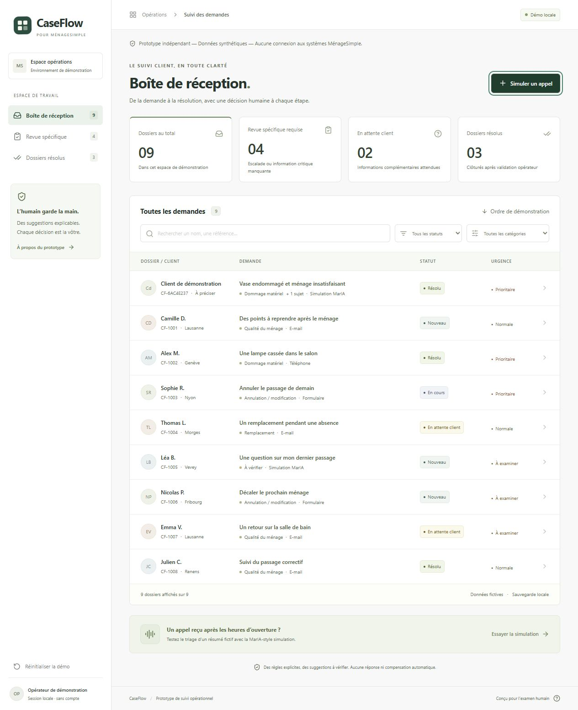

# MénageSimple CaseFlow

**[Ouvrir la démonstration en ligne](https://menagesimple-caseflow.vercel.app/)**

CaseFlow est un prototype de console de suivi des demandes clients pour MénageSimple. À partir d’un résumé d’appel, il aide un opérateur à identifier les sujets, réunir les informations utiles, préparer une réponse et suivre le dossier jusqu’à sa résolution.



## Fonctionnalités

- Boîte de réception avec recherche, filtres par statut et catégorie, et indicateurs calculés depuis les dossiers.
- Création d’un dossier depuis un résumé d’appel, détection de plusieurs sujets et suggestions de prochaines actions expliquées.
- Checklist des informations manquantes, correction motivée de la catégorie et brouillon de réponse éditable.
- Revue et approbation explicites avant résolution ; modifier une réponse invalide son approbation. Une clôture avec des informations critiques manquantes exige un motif.
- Historique des actions et sauvegarde locale conservée après rechargement.

## Choix techniques

L’interface utilise React 19, TypeScript strict, Vite 7 et Tailwind CSS 4. Les règles métier sont séparées des composants dans `src/domain`, avec des tests Vitest couvrant le triage, les transitions, les filtres, les indicateurs et les garde-fous.

Le triage repose sur des règles déterministes françaises : chaque suggestion peut être expliquée et testée. Un message non reconnu reste « À vérifier ». LocalStorage permet de reproduire le parcours sans serveur, compte ni clé API. Les décisions restent entre les mains de l’opérateur.

## Installation et vérification

Prérequis : **Node.js ≥ 22.12** et npm. Le fichier de verrouillage des dépendances est inclus.

```sh
npm ci
npm run dev
```

Vite affiche l’adresse locale à ouvrir. Pour vérifier et construire le projet :

```sh
npm test
npm run typecheck
npm run build
npm run preview
```

Le build est généré dans `dist/`. Aucun fichier `.env` n’est nécessaire.

## Développement assisté par IA

Codex a assisté l’implémentation, la rédaction des tests et la documentation. Les comportements sont vérifiables dans le code et les tests automatisés. Aucun LLM n’est appelé à l’exécution.

## Limites

Le prototype utilise des dossiers fictifs et ne se connecte pas aux systèmes de MénageSimple. Il n’envoie aucun message et n’exécute aucune réservation ou compensation. Les règles lexicales peuvent mal interpréter un message ; une revue humaine reste nécessaire. Le stockage est propre à chaque navigateur, sans authentification, synchronisation multi-utilisateur ni stockage des justificatifs.
